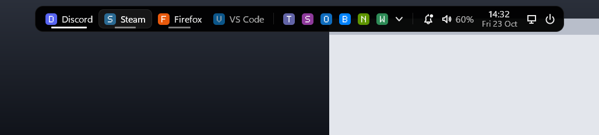
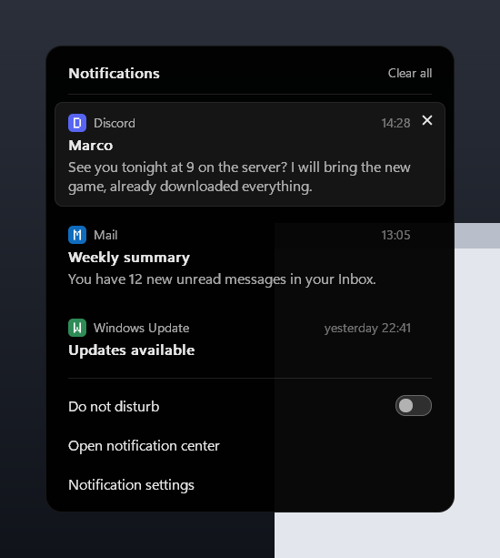
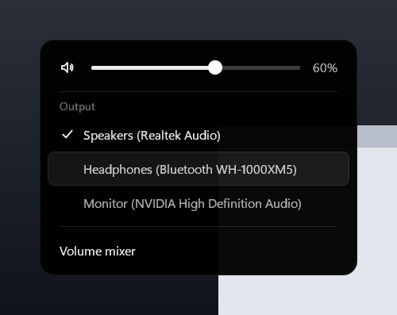
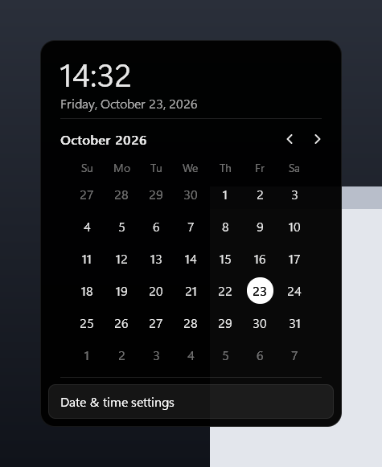
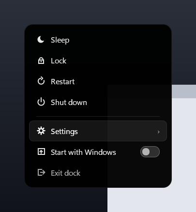
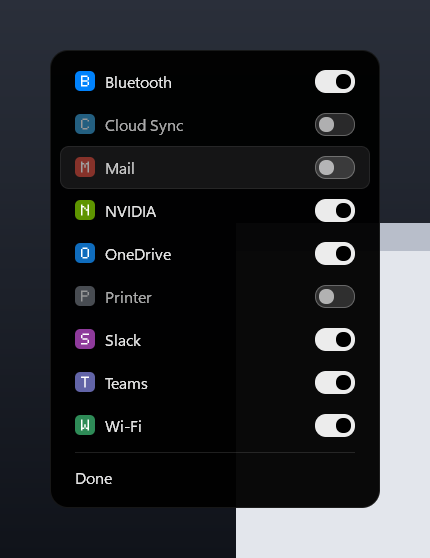

# mini-oled-dock

A minimal, ultra-light, OLED-black floating dock for Windows 11, written in Rust with raw Win32 and no UI framework.



It replaces the native taskbar with a small centred pill that hides when you do not need it. Backgrounds are pure black (OLED pixels switch off), only program names are shown (never window titles), tray icons of other apps are hosted in the bar, and the popups are drawn by hand. The executable is about 0.7 MB and uses roughly 10 MB of RAM (working set trimmed to under 1 MB while hidden); numbers from the author's machine.

*Screenshots are rendered offscreen by `dock.exe --preview` with mock data.*

| Notifications | Audio | Calendar |
|---|---|---|
|  |  |  |

| Power | Tray: choose visible icons |
|---|---|
|  |  |

## Features

- Centred bar sized to its content: pinned apps first, then open apps. An underline marks open windows (orange when an app asks for attention).
- Display modes: icon + name, icon only, or name only.
- Drag and drop reordering of apps, tray icons and system modules.
- Tray icon hosting, with an overflow popup and a view to choose which icons are visible.
- Popups: notifications (with Do not disturb), audio (volume, mute, output device), calendar, power, and an app menu (new window, pin / unpin, close).
- Show desktop button.
- **Win key toggles the dock** (Win+other-key shortcuts still work), including over fullscreen games.
- Auto-hide with a slide animation: the bar shows on the Win key or when the pointer touches the screen edge, and hides after 2.5 s.
- Autostart without UAC prompts (scheduled task).
- Watchdog process that always restores the native taskbar.
- Live reload of a commented JSON config.

## Install

Requires Windows 11 and a stable Rust toolchain (1.87+, MSVC target).

```powershell
git clone https://github.com/gitgiovik/mini-oled-dock
cd mini-oled-dock
cargo build --release
.\target\release\dock.exe
```

The exe asks for administrator rights (UAC prompt): a non-elevated process cannot manage windows of elevated apps, receive the Win key over them, or fully manage the native taskbar. Apps launched from the dock do NOT inherit the elevated token: they are started through the desktop shell as your normal user (if that is not possible the launch is refused).

To start with Windows (or use the toggle in the power popup):

```powershell
.\target\release\dock.exe --install     # copies the exe to %ProgramFiles%\mini-oled-dock and registers a logon task
.\target\release\dock.exe --uninstall   # removes the logon task
```

The logon task runs the dock elevated, so the installed copy lives in an admin-only folder (`%ProgramFiles%\mini-oled-dock\dock.exe`, inheriting the Program Files permissions) that normal programs cannot modify. Its data lives in `%ProgramData%\mini-oled-dock` (see [Data folder](#data-folder)).

**Update:** run `--install` again after rebuilding; if the installed dock is running it is asked to exit and restarted from the new copy. If you installed an older version, an old copy may be left in `%LOCALAPPDATA%\Dock\bin`: `--install` reports it but does not delete it (an elevated delete in a user-writable folder is unsafe), so delete that folder yourself once the old dock has exited.

**Uninstall:** `--uninstall` removes the logon task but keeps `%ProgramFiles%\mini-oled-dock` (it may be the copy currently running). Delete that folder from an elevated prompt if you no longer need it, and `%ProgramData%\mini-oled-dock` (also elevated) to remove your settings, logs and icons.

## Usage

- **Show / hide:** Win key alone, or the screen edge.
- **App entries:** left click activates, minimises or cycles windows; middle click starts a new instance; right click opens the app menu.
- **Volume:** wheel changes it, middle click mutes, left click opens the audio popup.
- **Exit:** `Ctrl+Alt+Q`, or the power popup, or `dock.exe --restore`.

## Configuration

`%ProgramData%\mini-oled-dock\config.json` is created on first start as commented JSON (`//` and `/* */` allowed) with a guide above every option. It reloads automatically within about 2 s. Missing fields take their default; on a syntax error the previous settings are kept and the error is logged.

**Editing by hand:** open it with Notepad (no admin rights needed). Notepad saves in place, which is allowed; editors that save by writing a new file and renaming it over the old one (many code editors do) cannot save here, so use Notepad or run your editor elevated. If a programmatic save happens while your edit has a syntax error, your version is first copied to `config.json.bak` next to it.

| Option | Default | Meaning |
|---|---|---|
| `position` | `"bottom"` | `"top"` or `"bottom"` |
| `display_mode` | `"icon_text"` | `"icon_text"`, `"icon"` or `"text"` |
| `autohide` | `true` | Hide the bar when the pointer leaves it |
| `hide_native_taskbar` | `true` | Hide the Windows taskbar while the dock runs |
| `show_date` / `date_format` | `true` / `"ddd d MMM"` | Date under the time (Windows date picture) |
| `time_format` / `show_seconds` | `"HH:mm"` / `false` | Clock format (Windows time picture) |
| `show_volume_percent` | `true` | Show `NN%` next to the speaker |
| `show_tray` | `true` | Host other apps' tray icons |
| `pinned` | `[]` | Pinned apps, in display order |
| `names` | `{}` | Display-name overrides (key: lowercase exe name or AUMID) |

Tray visibility and ordering (`tray_hidden`, `app_order`, `tray_order`, `modules_order`) are written by the dock itself.

**Tray icons of elevated apps.** The dock runs as administrator, so by default it refuses to send click, hover and menu messages to a tray icon whose window belongs to another elevated program: otherwise any normal program could register a fake icon pointing at an elevated window and use the dock to deliver messages Windows would block (a UIPI bypass). This opt-in is deliberately not in `config.json` (any program running as you can write that file); it is an admin-only registry value. To enable it, from an elevated PowerShell:

```powershell
New-Item -Path HKLM:\SOFTWARE\mini-oled-dock -Force; Set-ItemProperty HKLM:\SOFTWARE\mini-oled-dock TrustElevatedTrayIcons 1 -Type DWord
```

It is picked up within about 10 s. Set it to `0` or delete the key to turn it off. System messages (below `WM_USER`) are never forwarded to elevated windows either way.

A pinned app looks like this; `launch` is an exe path or `shell:AppsFolder\<AUMID>` (list AUMIDs with `Get-StartApps`), `icon` is an optional PNG in `%ProgramData%\mini-oled-dock\icons\` (you can drop files there without admin rights; at most 4 MB, no shortcuts, links or hard links), given as a plain file name only (paths, `..`, drive letters and UNC paths are rejected). Pinning from the right-click menu fills it in for you. Apps are always started without administrator rights, through the desktop shell, even though the dock itself is elevated; if that is not possible the launch is refused rather than run elevated.

```jsonc
{ "key": "c:\\program files\\discord\\discord.exe", "name": "Discord",
  "launch": "C:\\Program Files\\Discord\\Discord.exe", "icon": "discord.png" }
```

Run `dock.exe --list-apps` to see how each open window was named. Command-line flags (`--top`, `--bottom`, `--no-autohide`, `--keep-taskbar`, ...) override the config; `dock.exe --help` lists them all.

## Recovering the taskbar

The dock saves the original taskbar state before hiding it, and a separate watchdog process restores it if the dock crashes or hangs. If something still goes wrong:

1. Run `dock.exe --restore` from any terminal. It works even when no dock is running.
2. If the taskbar is still hidden, restart Explorer:

```powershell
Stop-Process -Name explorer -Force; Start-Process explorer
```

## Limitations

- Primary monitor only; the dock does not reserve work area, so maximised windows go under the bar.
- The notification list needs Windows notification access (asked once). Switching the audio output and Do not disturb use undocumented COM interfaces that a Windows update could break.
- Tray hosting only works while the native taskbar is hidden.
- Developed and tested on Windows 11 only.

## Data folder

Everything the dock stores is in `%ProgramData%\mini-oled-dock`:

| Path | What | Who can write |
|---|---|---|
| `config.json` (+ `config.json.bak`) | settings | you (edit in place) and administrators; the `.bak` copy is admin-only |
| `icons\` | your custom PNGs | you can add, replace and delete files |
| `cache\` | extracted icon cache (PNG) | administrators only |
| `dock.log`, `dock.log.1` | log, rotated at 2 MB | administrators only |
| `taskbar-state` | the original taskbar state, used to restore it | administrators only |

The dock runs elevated, so its data must not live where normal programs can plant links: an elevated write, rename or delete that follows a junction or hard link planted in a user-writable folder (such as the old `%LOCALAPPDATA%\Dock`) can be turned into an arbitrary file write or delete. The folder is therefore created by the elevated dock with its own protected permissions (administrators and SYSTEM full control, users read only); only `config.json` (read and write its content, not delete or rename it) and `icons\` (add files) are opened up for you, and custom icons are read with checks that refuse links and anything outside that folder. If the folder exists but was not created by an administrator (or is a link), the dock renames it away or, failing that, refuses it and runs without saving anything; the log (or DebugView, when there is no log) says to delete it from an elevated prompt.

**Upgrading from an older version:** on the first start the old `%LOCALAPPDATA%\Dock\config.json` is read once and saved in the new folder. Custom icons are not copied: move your PNGs from `%LOCALAPPDATA%\Dock\icons` to `%ProgramData%\mini-oled-dock\icons` yourself, then delete `%LOCALAPPDATA%\Dock` (the dock never writes or deletes anything there).

## Build notes

To render the screenshots, build with `DOCK_NO_MANIFEST=1` (a non-elevated manifest) and run `dock.exe --preview <folder>`.

## Credits and license

A few Windows shell protocol structures in `src/tray_host.rs` are adapted from [lightbar](https://github.com/SauerExe/lightbar) (MIT); see [THIRD_PARTY_NOTICES.md](THIRD_PARTY_NOTICES.md). Other shell projects were studied for protocol knowledge only; no AGPL code was copied.

[MIT](LICENSE) &copy; 2026 gitgiovik
